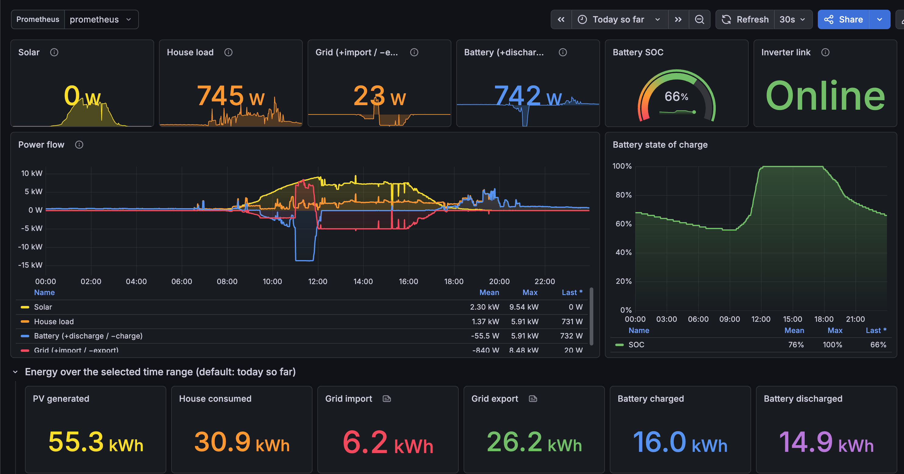

# GoodWe Exporter

<p align="center">
  
</p>

An exporter for GoodWe solar inverters, built on the
[`goodwe`](https://github.com/marcelblijleven/goodwe) library and packaged as a Docker container.

The inverter is read when Prometheus scrapes `/metrics`. Reads are cached for a few seconds, serialised,
and bounded by a timeout, so the inverter is never hammered and a dead inverter never hangs a scrape.

## Get started

The image is published on Docker Hub as
[`joeldroid/goodwe-exporter`](https://hub.docker.com/r/joeldroid/goodwe-exporter):

```sh
docker pull joeldroid/goodwe-exporter
```

### 1. Find your inverter's IP address

Look it up in your router's client list and give it a static lease so it does not change. The exporter
and the inverter must be on the same network, and the inverter must be reachable on UDP `8899` (or Modbus/TCP
`502`, see [Configuration](#configuration)).

### 2. Run it

**With plain Docker:**

```sh
docker run -d --name goodwe-exporter --restart unless-stopped \
  -p 9877:9877 -e INVERTER_HOST=192.168.1.50 \
  joeldroid/goodwe-exporter
```

**With Docker Compose:**

Save this as `docker-compose.yml` (it is the same as the [`docker-compose.yml`](docker-compose.yml) in this
repository, minus the `build` line):

```yaml
services:
  goodwe-exporter:
    image: joeldroid/goodwe-exporter:latest
    restart: unless-stopped
    ports:
      - "9877:9877"
    environment:
      INVERTER_HOST: ${INVERTER_HOST}
      INVERTER_PORT: ${INVERTER_PORT:-8899}
      INVERTER_FAMILY: ${INVERTER_FAMILY:-}
      CACHE_TTL_SECONDS: ${CACHE_TTL_SECONDS:-5}
      SCRAPE_TIMEOUT_SECONDS: ${SCRAPE_TIMEOUT_SECONDS:-8}
      LOG_LEVEL: ${LOG_LEVEL:-INFO}
    read_only: true
    cap_drop:
      - ALL
    security_opt:
      - no-new-privileges:true
```

Then start it, passing the inverter's IP address:

```sh
INVERTER_HOST=192.168.1.50 docker compose up -d
```

Compose also reads settings from a `.env` file next to `docker-compose.yml`, so you can keep them there
instead:

```sh
echo "INVERTER_HOST=192.168.1.50" > .env
docker compose up -d
```

### 3. Check that it works

```sh
curl localhost:9877/healthz
curl localhost:9877/metrics | grep goodwe_up
```

`goodwe_up 1` means the inverter was read successfully. If you see `goodwe_up 0`, check the logs with
`docker compose logs goodwe-exporter` and see [Things to know](#things-to-know) (inverters often stop
answering at night).

### 4. Point Prometheus at it

Add the scrape job from [`prometheus/prometheus.yml.example`](prometheus/prometheus.yml.example), changing the
target to wherever the exporter runs (for example `192.168.1.10:9877`), then reload Prometheus.

### Build from source

```sh
docker build -t joeldroid/goodwe-exporter .
INVERTER_HOST=192.168.1.50 docker compose up -d
```

## Configuration

| Variable | Default | Description |
|---|---|---|
| `INVERTER_HOST` | required | Inverter IP address or hostname |
| `INVERTER_PORT` | `8899` | `8899` = UDP; any other port (e.g. `502`) = Modbus/TCP |
| `INVERTER_FAMILY` | auto-detect | One of `ET EH BT BH ES EM BP DT MS NS XS` (`D-NS` is accepted for `NS`) |
| `INVERTER_TIMEOUT` | `1` | Per-request timeout in seconds |
| `INVERTER_RETRIES` | `3` | Per-request retries |
| `CACHE_TTL_SECONDS` | `5` | Minimum interval between real inverter reads |
| `SCRAPE_TIMEOUT_SECONDS` | `8` | Hard limit for one read. Keep below Prometheus' `scrape_timeout` |
| `LISTEN_ADDRESS` | `0.0.0.0` | |
| `LISTEN_PORT` | `9877` | |
| `LOG_LEVEL` | `INFO` | |

Broadcast discovery is not supported in the container (it does not cross Docker's bridge network), so
`INVERTER_HOST` is required.

## Endpoints

- `/metrics`: Prometheus metrics. Always `200`; a failed inverter read is reported as `goodwe_up 0`.
- `/healthz`: liveness of the exporter itself. It does not contact the inverter, so an inverter that sleeps
  at night will not get the container restarted.

## Metrics

Sensor metrics are generated from whatever the inverter family exposes, as
`goodwe_<sensor_id>_<unit>`, for example `goodwe_ppv_watts`, `goodwe_vpv1_volts`, `goodwe_e_day_kwh`.

- Lifetime totals (sensor id ending in `_total` with unit kWh or h) are **counters**, for example
  `goodwe_e_total_kwh_total`.
- Everything else is a **gauge**. Daily energy such as `e_day` resets at midnight, so it is a gauge.
- Missing (`None`) and text-valued sensors are not exported.

Exporter metrics:

| Metric | Meaning |
|---|---|
| `goodwe_up` | `1` if the last inverter read succeeded |
| `goodwe_info{model,serial,firmware,...}` | Inverter identity, always `1` |
| `goodwe_scrape_duration_seconds` | Duration of the last real inverter read |
| `goodwe_scrape_errors_total{reason}` | Failed reads: `timeout`, `connect`, `inverter_error`, `unexpected` |
| `goodwe_last_successful_scrape_timestamp_seconds` | Unix time of the last good read |
| `goodwe_exporter_build_info{version,goodwe_version}` | Versions |

Example queries:

```promql
goodwe_ppv_watts
increase(goodwe_e_total_kwh_total[1d])
rate(goodwe_scrape_errors_total[5m]) > 0
```

## Things to know

- **Night-time:** many inverters stop answering when there is no sun. `goodwe_up 0` is then normal. Alert on
  it only during daylight, or on `rate(goodwe_scrape_errors_total{reason!="timeout"}[...])`.
- **One client at a time:** the inverter's UDP endpoint copes poorly with several clients. Running Home
  Assistant's GoodWe integration or the SolarGo app against the same inverter will cause timeouts.
- **Slow reads:** `goodwe` retries internally and ignores cancellation, so the exporter gives up waiting after
  `SCRAPE_TIMEOUT_SECONDS` and refuses to start another read until the abandoned one finishes.

## Development

```sh
python3 -m venv .venv
.venv/bin/pip install -r requirements-dev.txt && .venv/bin/pip install -e .
.venv/bin/pytest
INVERTER_HOST=192.168.1.50 .venv/bin/python -m goodwe_exporter
```

The implementation plan is in [`docs/plans/`](docs/plans/goodwe-exporter.md).
